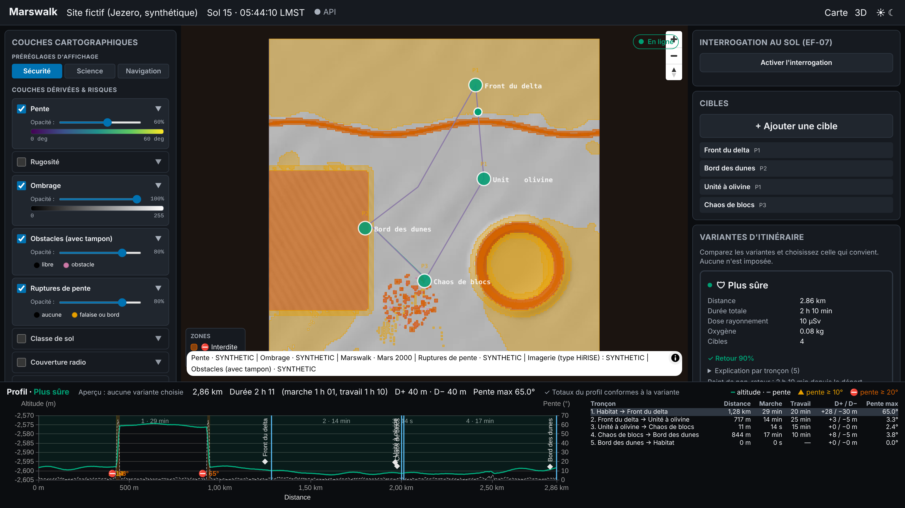

# F3 · Profil d'itinéraire

Panneau du bas de la vue carte : profil d'altitude et de pente de l'itinéraire affiché, en
fonction de la distance (EF-06).

## Ce que montre le panneau

- **Graphique ECharts** (rendu SVG) : altitude (ligne pleine, couleur de la variante) et pente
  (pointillés, axe de droite) en fonction de la distance cumulée.
- **Bandes de pente** : orange `▲` à partir de `penalty_slope_deg`, rouge `⛔` à partir de
  `max_slope_deg`, seuils lus dans les réglages du plan. Chaque bande porte son icône et sa
  pente maximale : la couleur n'est jamais le seul indice (ENF-06).
- **Tronçons** : numéro et durée de marche en haut du graphique, séparateurs en tirets, et un
  tableau à droite (distance, marche, travail à la cible, D+ / D−, pente max).
- **Cibles** : repère vertical `◆ nom` à la fin de chaque tronçon qui arrive sur une cible.
- **Point de non-retour** : repère `⚑` quand `return_check.point_of_no_return_time_s` tombe
  avant l'arrivée (s'il coïncide avec l'arrivée, le retour est garanti tout du long).
- **Totaux** : ceux de la variante (`route.totals`), suivis d'un contrôle qui les recalcule
  depuis le profil et les tronçons (`compareTotals`) et signale tout écart.

## Quel itinéraire

La variante active du magasin (`activeRouteId`) ; sinon celle retenue dans le plan quand il
est à l'état `selected` ; sinon la plus sûre, marquée « Aperçu : aucune variante choisie ».
F3 n'écrit jamais `activeRouteId` : aucune variante n'est imposée.

## Synchronisation (`hoverDistanceM`)

| Source | Effet |
| --- | --- |
| Survol du graphique | écrit la distance de l'échantillon le plus proche ; quitter le graphique l'efface |
| Survol d'une ligne du tableau | écrit le milieu du tronçon |
| Survol de l'itinéraire sur la carte | couche deck.gl invisible `f3-route-hover` (16 px) : écrit la distance de l'échantillon le plus proche (géodésie de C1, à moins de 40 m) |
| Valeur venue d'ailleurs (carte, 3D) | trait vertical sur le graphique et ligne du tableau surlignée |
| Toute valeur | repère `f3-hover-marker` sur la carte, position interpolée le long du profil |

La vue 3D (F6) lit et écrit la même valeur ; le panneau n'apparaît qu'en mode carte.

## Fichiers

| Fichier | Rôle |
| --- | --- |
| `profileData.ts` | Calculs purs : choix de la variante, bandes, tronçons, cibles, totaux, survol, formats |
| `chartOption.ts` | Option ECharts (pure, testée sans canevas) |
| `ProfileChart.tsx` | Graphique et liaison du survol avec le magasin |
| `ProfilePanel.tsx` | En-tête, totaux, graphique et tableau des tronçons |
| `mapLayers.ts` | Couches deck.gl (repère et capture du survol) |
| `useProfileRoute.ts` | Plan et cibles par les clés partagées de TanStack Query |
| `fixtures/plan-p3.json` | Plan réel du site fictif calculé par P3 (variantes `safest` et `science`) |

## Tests

`pnpm --filter web exec vitest run src/features/profile` : 27 tests sur le plan réel de P3, dont
les deux critères d'acceptation (survol profil → carte et carte → profil ; totaux du profil
égaux à ceux de la variante, pour chaque variante).
